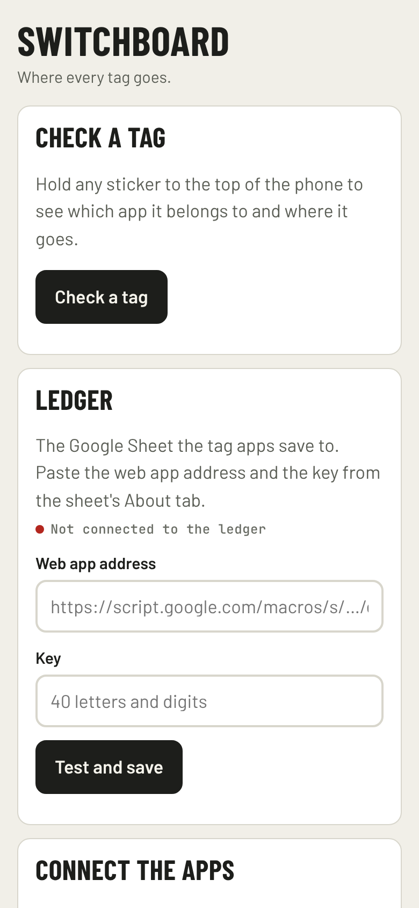

# Switchboard

**Use it: [tag.junkdrawer.works](https://tag.junkdrawer.works/)** (writing stickers needs Chrome on an Android phone)

**One short link on every NFC sticker, sent on to the app that owns it, plus the shared ledger those apps save to.** Every sticker holds `https://tag.junkdrawer.works/<letter>/<id>`. The letter picks the app (h Placard, t Mothball, p Larder, f Frostbite, m Packrat) and the id is the thing the sticker is on. Because the sticker points here rather than straight at an app, any tag can be sent somewhere else later without rewriting it.

<p align="center">
  
</p>

## How it works

- **The resolver.** `404.html` answers every tag address (GitHub Pages serves it for any path it doesn't have) and forwards the phone to `https://<app>.junkdrawer.works/#<id>`. `OVERRIDES`, a small script of its own at the top of the same file, sends single tags elsewhere. A mistake typed into it (a comma left out, a curly quote) loses only those: every sticker still opens its own app.
- **The ledger.** `ledger/Code.gs` is a Google Apps Script for a Google Sheet you own: each tab is one app's collection, each row a record. The apps, a Raspberry Pi and ESP32 boards all read and write it with one key. Only the house manual's pages are readable without the key. Once it's connected, the Ledger card says how to undo a mistake in the sheet: FALSE in a deleted record's row brings it back, and a version restored from Version history reaches the phones with the sheet's Ledger menu.
- **Connect.** Each app lives at its own address, so each needs the ledger once. Switchboard makes a link per app that carries the address and key and opens the app with them filled in. **Another device**, under the ledger, shows Switchboard's own link as a QR code, so a second phone or tablet is set up with one scan; it carries the key, so it's drawn only when asked.
- **Needs a look.** Once connected, Switchboard opens on one card of what's due across the apps, each line a link into its app: "Freezer: 2 past best, 2 to use soon", "Packs: 03 weak", "Rental: 1 new report", "Larder: 1 on the list", "Totes: Christmas is next month. Tote 02 comes down."; "Nothing needs a look." otherwise. Each app publishes a small `js/attention.js` built on its own rules, which Switchboard imports from the app's address and hands that app's records, read from the ledger with the key it already holds (it only lists; it never writes). What each app said last is kept on the device, so with no signal the card still shows it, with its time. The setup cards (the ledger, Connect, the test sticker, the letters) fold under **Setup** once connected, which also takes the key off the first screen; an app's Open Switchboard link opens it at Connect.
- **Find anything.** Under Needs a look, one box searches every app at once: tote contents and build cards, freezer food, Larder's shelves and jars (with where they're kept and whether they're on the list), packs (and who has one) and the house manual's pages. Each app's `js/attention.js` says what its own search looks through, and Switchboard matches the words the same way (the kit's `find.js`), so each result names its app and place ("Spare fuses", "Mothball · Tote 03 · Christmas lights") and opens it there.
- **Check a tag.** Hold any sticker to the phone to see which app it belongs to and where it goes, `OVERRIDES` included. Once connected, it also names what the sticker is for ("Cumin, ground · Spice drawer"), or says it isn't set up in its app yet. It also says when a mistake typed into `OVERRIDES` means no sticker is sent elsewhere, or when one in the rest of `404.html` stops every tap. Web NFC needs Chrome on Android.
- **Privacy.** [`privacy.html`](https://tag.junkdrawer.works/privacy.html) is the tag apps' privacy page, and every app's Privacy link goes to it: what goes to your Google Sheet, that the house manual is public, and what a tenant's report sends and to whom.
- **Offline.** Any phone that has tapped one sticker online keeps a copy of the resolver (about 250 KB, fetched in the background on that first tap), so a later tap with no signal, or on one bar that never answers, still reaches the app's offline copy within a few seconds.

## Running it

It's a static site: plain HTML, CSS and JavaScript, with no build step.

```sh
npx http-server -p 8080 -c-1 .   # then open http://localhost:8080
npm test                         # unit tests, then the page in Chromium with a pretend NFC reader
node tools/make-icons.mjs        # PNG icons from icon.svg
```

GitHub Pages serves it from `main`, `/ (root)`, at its own address (`CNAME`).

### Files

- `index.html`, `css/app.css`, `js/app.js`: the Switchboard page; `js/overrides.js` reads `404.html`'s two scripts as the page runs them, so Check a tag shows where a tap really goes; `js/look.js` reads each app's records (lists only) and hands them to the app's own `js/attention.js` for Needs a look, Find anything and Check a tag's names.
- `404.html`: the resolver.
- `ledger/Code.gs`: the ledger web app.
- `js/kit/`, `css/kit.css`: the kit every tag app shares: ledger client, Web NFC, small UI helpers, and the QR code maker Another device uses.
- `fonts/`: Barlow, Barlow Condensed and JetBrains Mono (SIL Open Font License), served from here so nothing loads from elsewhere.
- `test/`: the ledger round trip against a pretend Google Sheet, the resolver, and the page in Chromium (`test/e2e.mjs`, `test/app-checks.mjs`), offline included.

